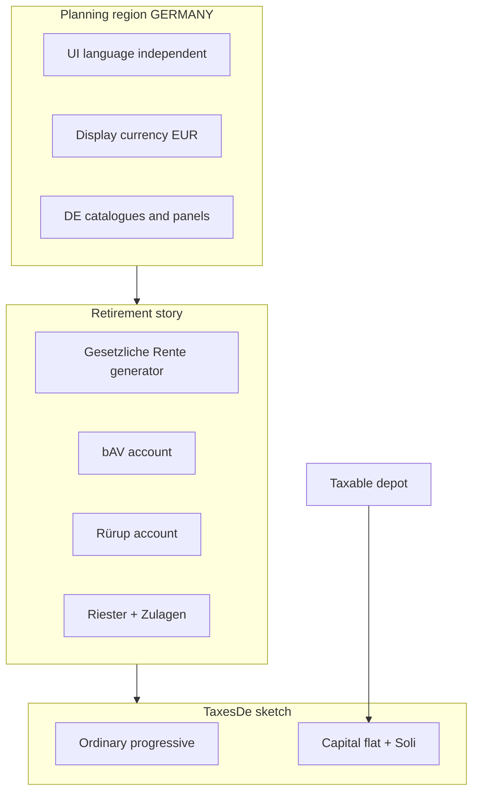

<!--
tutilis-return: kotlin/website/src/main/resources/content/dossiers/germany_starter.md
tutilis-locale: en source
-->
# Germany Starter

<!---
  GENERATED lesson shell — not learner-facing meta. Regenerated chrome is
  outside α/ω; teaching prose lives only in the protect block.
  outline-id: household.place.germany_starter
  outline-path: Household planning › Place and region › Germany starter vehicles
  document-id: germany_starter
  locale: en
  lifecycle: Source
  status: Shipped
  lesson-status: PortedFromPublic
  host-hint: Dossier
  intent: Planning-region personality; deepen after catalogues.
  port-source: dossiers/germany_starter.md
-->

<!--- α <lesson_body> -->
This is the **first European plan** in the Learning Center: a German household with **EUR**
balances, **German account types**, a **Gesetzliche Rente** cash-flow generator, and a
**TaxesDe** income-tax sketch — not a US dossier with different labels.

The live plan on the right is **Germany Starter** (`germany_starter`): Lukas and Mia, mid-career
in Germany. Use it to see how **planning region** shapes the product personality before you dig
into any single vehicle.

For the US contrast, where one product word names two separate tax systems, see
[Social Security treatment](/learn/social_security_treatment).

---

## What you will learn

<aside class="lesson-plan">

Today's lesson

By the end of this lesson you should be able to answer these questions. Each one links to the
section that answers it.

1. **How is a plan's planning region different from the language the app speaks?** See
   [Language vs planning region](#language-vs-planning-region).
2. **Who is in this German plan, and when do they plan to retire?** See
   [Who is in this plan?](#who-is-in-this-plan).
3. **How do Germany's retirement pillars sit on one EUR balance sheet, and why is the statutory
   pension a generator while the workplace pension is an account?** See
   [Pillars on one balance sheet](#pillars-on-one-balance-sheet).
4. **What does the Germany tax statement cover, and where does the sketch stop?** See
   [What TaxesDe is](#what-taxesde-is-and-is-not).
5. **What goes wrong if I treat a German plan as a US plan with a euro symbol?** See
   [Why this matters](#why-this-matters).

</aside>

---

## Language vs planning region

The language the app speaks and the country the plan models are two separate settings, and they
are easy to mix up.

| Concept | What it is | Where you feel it |
|---------|------------|-------------------|
| **UI language** | EN / DE / FR / ES copy for labels and help | Language control in chrome |
| **Planning region** | Which country’s **product personality** the plan uses | Toolbar [[nav:region]] chip; catalogues; tax plugin |

You can read the app in **English** and still plan a **German** household. Language is how the
shell speaks; planning region is **which rules and vehicles** the dossier carries. This sample’s
region is **Germany**; display currency is **EUR**.

---

## Who is in this plan?

The plan models two people, Lukas and Mia.

| Person | Role | Birth year | Plans to retire | Plan models life to |
|--------|------|------------|-----------------|---------------------|
| **Lukas** | Primary owner | 1980 | age 67 | age 92 |
| **Mia** | Secondary owner | 1982 | age 67 | age 94 |

Both target **67** for plan retirement — a common statutory-retirement story for a first German
sample, not a claim that every German household retires in lockstep.

**Where to look:** [[nav:birds-eye]] → People (or the people area on Dossier). [[term:hover|Hover]] a card for birth
year and the age · calendar-year pairing when the UI shows it.

[[jump:horizon|output__birds-eye__birds-eye.people-events]]

---

## Pillars on one balance sheet

Germany’s retirement story is often told as **pillars**. This sample puts several of them in one
plan so you can see **product identity**, not just another savings pot with a different name.

| Layer | In this sample | What it is for |
|-------|----------------|----------------|
| **Taxable depot + giro** | Brokerage ETFs + checking | Spendable / taxable wealth and cash |
| **Pillar 1 — statutory** | **Gesetzliche Rente (Lukas)** generator | National public pension (cash-flow template) |
| **Pillar 2 — workplace** | **bAV** (Direktversicherung sketch) | Employer occupational pension account |
| **Pillar 3 — private** | **Rürup** (Basisrente) + **Riester** | Self-directed / subsidized private contracts |

### Accounts to open

1. **Depot (taxable [[term:brokerage]])** — Europe-facing holdings: developed **ex-US** equity, emerging
   markets, Euro aggregate bonds (thin DE/EU market pack — reuses existing growth types).
2. **Girokonto (checking)** — demand / cash personality.
3. **bAV (Direktversicherung sketch)** — workplace pot; annual contribution until start age **67**.
4. **Rürup (Basisrente sketch)** — higher private contribution sketch; same contract shape for now.
5. **Riester (sketch)** — own contribution **plus** an **annual Zulagen** sketch (€475 total —
   illustrative basic + one child, **not** a full statutory table by tax year).

bAV, Rürup, and Riester share a **contract shell** today (capital, contribution, start age, [[term:cola]]).
That is intentional MVP reuse. **Labels and the sample story** carry most of the identity until
vehicle-specific tax and subsidy depth deepen. Riester is the one that already shows a
**Zulagen** line expanding separately from own contribution.

### Cash flows and generators

| Item | Role |
|------|------|
| **Primary salary** | Earned income through the handoff into retirement years |
| **Living expenses** | Ongoing household spend |
| **Gesetzliche Rente (Lukas)** | Monthly benefit sketch → annual series from start age **67**, with COLA |

**Employer bAV is an account**, not a second portable “pension generator.” Statutory pension is the
**generator**; workplace capital sits on the **balance sheet**.

---

## Where to look

The plan’s inputs sit in the definitional views, and the year-by-year results sit in the
Forecaster.

### Definitional

1. **Toolbar** — plan title next to [[nav:region]] (Germany) and **display currency** (EUR).  
2. [[nav:birds-eye]] / [[nav:dossier]] → accounts — depot, giro, bAV, Rürup, Riester.  
3. **Cash Flow** selector on [[nav:birds-eye]] — salary, living spend, and expanded contract contributions /
   Zulagen once the plan expands.  
4. [[nav:assumptions]] / Taxes — **TaxesDe** is installed (empty `TaxesDe {}` means built-in sketch
   defaults). There is a first-year tax **estimate** anchor as well; the Forecaster statement is the
   year-by-year path.

### Projected — [[nav:forecaster]]

Prefer **[[term:fid-gmf|FID 0 / GMF]]**. Use **Year** to jump between a **working** year and a **post-67** year.

| View | Role here |
|------|-----------|
| [[nav:cf-chart]] / [[nav:cf-table]] | Salary while working; Gesetzliche Rente and contract behavior after start ages. |
| **Taxes → Germany** | Dual-track **sketch** statement (ordinary progressive + capital flat + Soli) — not a US federal worksheet. |
| **Simulation Summary** | Multi-path outcomes on a EUR-native book. |

Chart controls: [Close up / zoom / Reveal](/learn/getting_around#chart-chrome).

---

## Try this

Work these steps on the plan on the right. The first confirms the plan is German, the second
traces the pillars while Lukas and Mia work, and the third reads a year after the statutory start age.

### A. Confirm you are not in a US plan

1. Read the toolbar: [[nav:region]] should show **Germany**, display unit **EUR**.  
2. Open accounts: you should see **bAV / Rürup / Riester / Gesetzliche Rente** vocabulary — not
   [[term:traditional|Traditional]] [[term:ira]] / [[term:roth]] / Social Security as the primary cast.  
3. Open [[nav:path:forecaster|taxes]]. You should get a **Germany** tax card (sketch notes included), **not**
   the US federal “totals-first” Social Security / [[term:fica]] layout from the US lessons.

[[jump:ordinary-income|output__forecaster__forecaster.forecast-detail__taxes__taxes.germany-statement]]

### B. Trace pillars before retirement

1. On [[nav:birds-eye]], select **Cash Flow** if available and find **Primary salary** and **Living
   expenses**.  
2. Open the **Riester** account: note **own contribution** and **annual Zulage** as separate
   ideas — Zulagen are state bonus capital, not “just a higher contribution field with no story.”  
3. Open **bAV** and **Rürup**: same shell, different product names and contribution magnitudes in
   the sample.

[[jump:cash-flow|output__birds-eye__birds-eye.mode.cash-flows__birds-eye.assets-liabilities]]

Prefer “three different German vehicles on one sheet” over memorizing euro amounts.

### C. After statutory start age

1. Scrub **Year** to a year when Lukas is **past 67** (sample birth **1980** → roughly plan year
   **2047+** depending on as-of year).  
2. On **CF**, look for **Gesetzliche Rente** as benefit cash (generator expand), distinct from
   taxable depot sales.  
3. On **Taxes → Germany**, skim ordinary vs capital tracks if the year has both wage/pension-like
   flows and taxable-account gains. Treat numbers as **illustrative sketch**, not a [[term:bmf]] notice.

### How the pieces relate

---

## What TaxesDe is (and is not)

TaxesDe is the Germany tax plugin on this sample, and it is a sketch rather than full national tax
software.

Reference — what the TaxesDe sketch covers

| It is | It is not |
|-------|-----------|
| Year-by-year **ordinary** progressive ladder + **capital** flat (Abgeltungsteuer-style **26.375%** sketch) + **Soli** on ESt | Full BMF Einkommensteuer (zone formula, Sonderausgaben, Kinderfreibetrag, …) |
| Enough for Germany Starter to show a **Germany** statement instead of “not modeled” | Kirchensteuer, Sparerpauschbetrag, freigrenze fidelity |
| Honest UI notes that this is a **sketch** | Accurate Ertragsanteil / contribution deductibility for every DE vehicle payout |

The **26.375%** capital rate is the 25% flat tax plus the 5.5% solidarity [[term:surcharge]] on that tax
(25% × 1.055).

US federal benefit inclusion (0/50/85%) and FICA payroll are **different systems** for a different
region — see [Social Security treatment](/learn/social_security_treatment). Do not read the Germany
card as if it were that worksheet.

---

## What this is *not*

| Not this lesson | Where that lives |
|-----------------|------------------|
| Full statutory **Zulagen** tables by tax year / child cohort | Product note: Riester sketch only; later tax/reference pass |
| **Wohn-Riester** / housing path | Deferred region work |
| Deep **Ertragsanteil** and contribution deductibility | TaxesDe follow-ons |
| US **Social Security** claim age or FICA vs benefit tax | [Social Security treatment](/learn/social_security_treatment), [Claim early vs live long](/learn/springfield_claim_longevity) |
| How to tour chrome and Forecaster in general | [Getting around the app](/learn/getting_around) |

Design depth for builders (not required for this walkthrough):
`doc/planning-regions/germany/` (vehicles, TaxesDe sketch, market pack).

---

## Why this matters

| If you only… | You can miss… |
|--------------|---------------|
| Treat Germany as “US plan + euro symbol” | Wrong vehicles, wrong tax card, wrong mental model for hard-cut when switching region |
| Collapse bAV / Rürup / Riester into “three IRAs” | You lose pillar identity (workplace vs Basisrente vs subsidized Riester + Zulagen) |
| Expect finished national tax software | You over-trust a **sketch** statement that is meant to be inspectable and improvable |
| Mix **UI language** with **planning region** | You think changing the language rewrote the tax system (it does not) |

This sample exists so the first European country is a **real product slice** — region, currency,
catalogues, generators, accounts, and a tax path that admits its limits — not a screenshot of
intent.

---

## Where to go next

| Lesson | Why |
|--------|-----|
| [Getting around the app](/learn/getting_around) | Shared navigation for every later lesson |
| [Social Security treatment](/learn/social_security_treatment) | US contrast: payroll FICA vs benefit inclusion |
| [Tax-account order vs pro-rata](/learn/springfield_tax_order) | US residual funding order (different region, same Forecaster habits) |
| [Meet the Springfield household](/learn/springfield_baseline) | US baseline cast if you are learning the app on USD samples first |
<!--- ω <lesson_body> -->

<!-- GENERATED host-hint: Dossier — Live plan canvas — Bind a sample dossier on the right. -->
