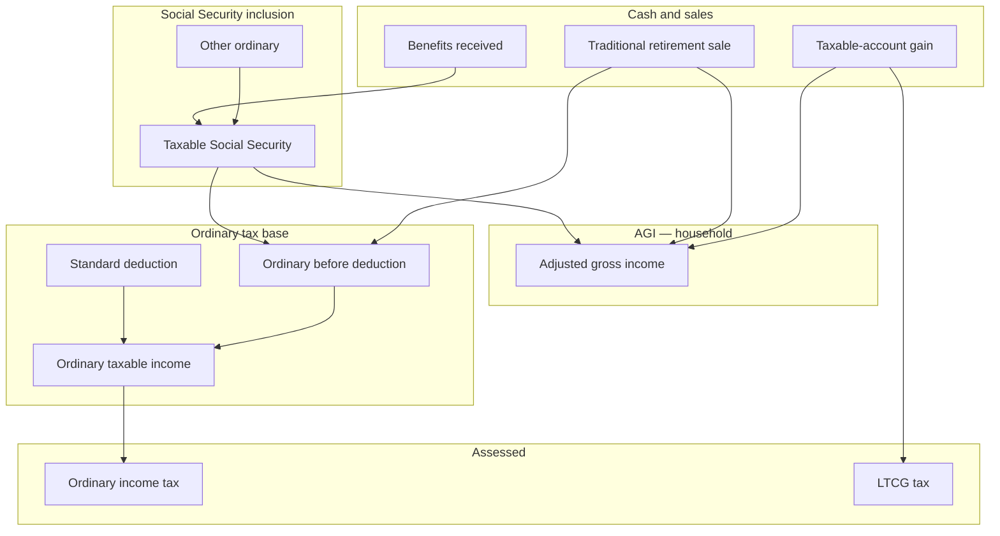

<!--
tutilis-return: kotlin/website/src/main/resources/content/dossiers/social_security_treatment.md
tutilis-locale: en source
-->
# Social Security treatment

<!---
  GENERATED lesson shell — not learner-facing meta. Regenerated chrome is
  outside α/ω; teaching prose lives only in the protect block.
  outline-id: taxes_benefits.social_security.treatment
  outline-path: Taxes, benefits, and retirement systems › Social Security › Benefits taxation vs payroll FICA
  document-id: social_security_treatment
  locale: en
  lifecycle: Source
  status: Shipped
  lesson-status: PortedFromPublic
  host-hint: Dossier
  intent: Ported from public dossiers/social_security_treatment.md — teaching body unchanged.
  port-source: dossiers/social_security_treatment.md
-->

<!--- α <lesson_body> -->
**Social Security** shows up in two completely different places in a US plan. This lesson names
both, shows where each appears on the **federal tax statement**, and walks you through reading
them on a live sample.

| Concept | What it is | Where you see it |
|---------|------------|------------------|
| **Payroll Social Security (FICA)** | **6.2%** employee tax on **earned income** (wages), wage-base capped | Federal tax statement → **Social Security payroll (FICA)** |
| **Social Security *benefits*** | Your retirement check — only **part** may be taxable | Federal tax statement → **Social Security benefits** section |

Payroll [[term:fica]] is **not** “tax on your benefit.” Benefit taxation is **not** the 6.2% line. Same
product word, two IRS systems — keep them separate when you read the statement.

The live plan on the right is **Social Security Sample** (`social_security_sample`): Alex’s
baseline household (working income, living spend, multi-bucket portfolio) **plus** a Social Security
cash-flow template (PIA-style benefit, claim at full retirement age). US federal + **Ohio** state
taxes are on.

If you paste an SSA **statement** monthly amount and the plan **retires years before claim**, the
app warns that statement figures usually assume continued earnings through claim — see
[Pasting an SSA statement](#statement-paste-vs-early-retirement) below (best tried on
desktop, where the Social Security generator is editable).

---

## What you will learn

<aside class="lesson-plan">

Today's lesson

By the end of this lesson you should be able to answer these questions. Each one links to the
section that answers it.

1. **Is the Social Security tax on my paycheck the same thing as tax on my benefits?** See
   [Two systems, one product word](#two-systems-one-product-word).
2. **How much of a Social Security check counts as taxable income?** See
   [Two systems, one product word](#two-systems-one-product-word).
3. **Does my state tax Social Security the same way the IRS does?** See
   [Two systems, one product word](#two-systems-one-product-word).
4. **Why can a pasted SSA statement overstate my benefit if I retire early?** See
   [Pasting an SSA statement](#statement-paste-vs-early-retirement).
5. **What goes wrong when a plan taxes the whole benefit as ordinary income?** See
   [Why this matters](#why-this-matters).

</aside>

---

## The question

When the plan has **wages** and later **Social Security benefits**, can I open the **tax statement**
and see:

1. **FICA** only while there is [[term:earned-income]] — clearly labeled as **payroll**, not benefits?
2. **Benefits received** (the full check) vs **Taxable Social Security** (the inclusion that
   actually enters [[term:ordinary-income]]) after claim?
3. That modest benefit-only years are **not** taxed as if 100% of the check were ordinary wages?

---

## Two systems — one product word

The words *Social Security* name two separate federal tax systems, and the tax statement shows
each one in its own place.

### 1. Payroll Social Security (FICA) — tax on *work*

While Alex has **Working Income**, the federal statement assesses:

- **Social Security payroll (FICA)** — ~6.2% of earned income up to the wage base  
- **Medicare** — ~1.45% of earned income  

These are **payroll taxes on wages**, not a levy on the retirement benefit. [[term:basis|Basis]] is **earned
income**. When wages stop, these lines go to **$0** even if Social Security benefits continue.

Think of FICA as the “comes out of the paycheck” Social Security tax — the engine shows it as its
own assessed line so it never looks like benefit inclusion.

### 2. Taxation of Social Security *benefits* — tax on *retirement income*

After claim, benefits appear as cash inflow. Federally, benefits are **not** automatically 100%
ordinary income. The IRS uses a **provisional-income** test ([[term:ss-benefit-inclusion|combined income]]): roughly other [[term:agi]] +
half the benefits. That places the household in one of three **inclusion** bands:

| Band | Rough idea | Inclusion of benefits |
|------|------------|------------------------|
| Below the base threshold | Modest other income | **0%** taxable |
| Middle band | More other income | Up to **50%** |
| Upper band | Higher other income / larger plan | Up to **85%** |

Thresholds are **fixed statutory dollars** (they do **not** inflate with our tax-bracket growth
curve). Over long forecasts, that means more of a growing [[term:nominal]] benefit can become taxable —
that is intentional honesty, not a bug.

<aside class="lesson-did-you-know">

Did you know?

The income thresholds that decide whether Social Security is taxed have never been adjusted for
[[term:inflation]]. Congress set them at **\$25,000** for a single filer and **\$32,000** for a married couple
in 1983, when they reached only a small share of retirees. Today about half of the families who
receive Social Security pay some income tax on it.

</aside>

**What the statement must show (audit rows):**

| Row | Meaning |
|-----|---------|
| **Benefits received** | Full annual benefit (cash reality) |
| **Taxable Social Security** | Amount included in ordinary income after 0/50/85% |
| **Adjusted gross income** | Sparse federal AGI used for this worksheet (and future cliffs) |
| **Ordinary income** (assessed) | Uses the **taxable** inclusion — not the full check |

If **Taxable Social Security** is less than **Benefits received**, the plan is **not** overstating
federal ordinary tax on benefits the way a naïve “tax 100% of SS” model would.

### 3. State treatment (bonus — not the federal inclusion)

This sample files **Ohio**. Many states **exclude** Social Security from the state base entirely.
On the **state** tax statement you may see **Social Security excluded** under Adjustments — that is
**state** law, separate from the federal 0/50/85% inclusion. Do not mix the two tables.

---

## Where to look

The plan’s inputs sit in the definitional views, and the year-by-year results sit in the
Forecaster.

### Definitional

1. [[nav:birds-eye]] → People — **Alex** card: birth **1969**, age as-of the plan year, **Retire age**
   paired with calendar year (e.g. **65 · 2034**), **Death age** with year. [[term:fra]] claim is later than
   plan retirement on this sample.  
2. **Cash flows / generators** — **Working Income** until retirement; **Alex Social Security**
   (template expands to yearly benefits after claim).  
3. [[nav:assumptions]] / Taxes — US federal schedules; [[term:filing-status]] **Single**; state **OH**.

### Projected — [[nav:forecaster]]

Turn on [[nav:taxes]] (and CF if you want the cash side). Prefer **[[term:fid-gmf|FID 0 / GMF]]**. Use **Year** to jump
between a **working** year and a **post-claim** year.

| Preview | View | Role here |
|---------|------|-----------|
| [[img:ssx-cf-chart|preview]] | [[nav:cf-chart]] | Wages stop; SS benefits appear after claim. |
| [[img:ssx-cf-table|preview]] | [[nav:cf-table]] | Selected year: income vs tax outflows. |
| | **Taxes → US federal** | **Payroll FICA** vs **Social Security benefits** section — the core of this lesson. |
| | **Taxes → State (OH)** | Optional: SS excluded from state base. |

There is no separate “tax statement” dossier id — open [[nav:path:forecaster|taxes]] on this sample after
simulation (already populated in the Learning Center).

[[jump:fica]]

Chart controls: [Close up / zoom / Reveal](/learn/getting_around#chart-chrome).

---

## Try this

Work these steps on the plan on the right. The first reads a working year, the second reads a year
after the claim, and the third is an optional contrast sample.

### A. Working year — payroll only

1. Scrub **Year** to a pre-retirement year with **Working Income** (e.g. early in the plan).  
2. Open **Taxes → US federal**.  
3. Confirm **Social Security payroll (FICA)** has a **non-zero basis** (earned income) and tax.  
4. Confirm there is **no** “Social Security benefits” section yet (benefits not received).  
5. **Medicare** should also track earned income.  

Prefer “FICA is on **wages**” over any single dollar amount.

### B. After claim — benefits evidence

1. Scrub **Year** to a year **after** Social Security has started (e.g. **2036** on this sample —
   post-FRA claim; Alex is past retirement).  
2. On **Taxes → US federal**, read **totals-first groups** (no extra section titles — the parent
   *is* the group name):  
   - **Taxable Social Security** → children: benefits received, inclusion % (e.g. **85%** —
     inclusion rate, not a tax rate).  
   - **Adjusted gross income** → children: non-zero AGI ingredients (taxable SS, [[term:traditional]],
     **[[term:ltcg]]** when present, …). This is **the** household AGI.  
   - **Ordinary [[term:taxable-income]]** → children: ordinary ingredients + [[term:standard-deduction]] (no LTCG).  
   - **Total tax** → children: ordinary / LTCG / FICA / Medicare lines (basis + assessed).  
3. Match **Traditional retirement** to Money Movements sales marked **🛡️** ([[term:tax-deferred]]).  
4. **Social Security payroll (FICA)** should be **$0** if there is no earned income that year.

[[jump:ss|output]]

### How the numbers connect

Repeating a dollar under two parents (e.g. taxable SS in AGI and in ordinary base) is intentional:
same figure, different question. LTCG is in **AGI** and **Assessed**, not in ordinary base.

### C. Optional contrast — Social Security Only

Open **Social Security Only** (`social_security_only`) in a second tab: person + SS template, **no**
portfolio wages. On modest benefit-only years, federal **Taxable Social Security** often sits at
**$0** (below the provisional-income base). That is the “we no longer tax the whole check by
default” proof in its purest form.

Prefer “inclusion **depends on other income**” over memorizing the statutory threshold table.

---

## Pasting an SSA statement {#statement-paste-vs-early-retirement}

SSA **statement** (or estimator) lines are often **already age-adjusted** for a [[term:claim-age]] and
implicitly assume you keep earning toward that claim. If the **dossier retires much earlier**, the
pasted monthly amount can be **optimistic** relative to a stop-work-early path.

| Piece | Behavior |
|-------|----------|
| Benefit source | **Statement-based** (not PIA-at-FRA continuum) |
| Trigger | Plan **retirement age** ≥ **2 years** before resolved **claim age** |
| Where | [[nav:dossier]] (desktop) → Social Security cash-flow generator → statement fields |
| What you see | Inline honesty warning — no automatic benefit cut; you re-check with SSA or switch source |

This sample uses a **PIA-style** template, so that warning may not appear until you switch the
generator to **Statement-based** and set retirement well before claim (desktop). The tax-statement
walk in sections A–C does **not** require that edit.

---

## What this is *not*

| Not this lesson | Where that lives |
|-----------------|------------------|
| When to **claim** (62 / FRA / 70) | [Claim early vs live long](/learn/springfield_claim_longevity) |
| OASDI **wage base** / eliminating the payroll cap | [Erin On The Wage Cap](/learn/erin_on_wage_cap) |
| Early-withdrawal **10%** on traditional IRAs before 59½ | Forecaster Money Movements **Early withdrawal** reason and tax line when it applies |
| Full IRMAA / ACA subsidy cliffs | [MAGI cliffs — IRMAA, NIIT, and friends](/learn/magi_cliffs_irmaa_niit) |
| Pre-65 / Medicare phase **coverage** checks | [Healthcare expense phases](/learn/healthcare_expense_sample) |
| Required RMD path across years | [Forced traditional RMD](/learn/banks_forced_rmd) (Forecaster chip **Brackets**) |
| Germany / non-US pensions | [Germany Starter](/learn/germany_starter) |
| How SS templates expand to yearly amounts | [Social Security Sample](/learn/social_security_sample) |

---

## Why this matters

| If you only… | You can miss… |
|--------------|---------------|
| Treat every “Social Security” tax line as benefit tax | You will misread **FICA on wages** as “the government is taxing my check again” |
| Assume 100% of benefits are ordinary income | **Modest** retirees look poorer after tax than they are; conversion math is wrong |
| Ignore the **Taxable Social Security** row | You cannot audit the **tax torpedo** (extra ordinary income that pulls more benefits into tax) |

This feature exists so Setup / Explore answers about retirement income are **not biased** by a silent
full-inclusion shortcut — and so the tax statement stays **honest and inspectable**.

---

## Where to go next

| Lesson | Why |
|--------|-----|
| [Erin On The Wage Cap](/learn/erin_on_wage_cap) | W-2 and SE $300k walks + Transforms cap elimination |
| [Claim early vs live long](/learn/springfield_claim_longevity) | Claim age × longevity on Springfield |
| [Tax-account order vs pro-rata](/learn/springfield_tax_order) | Which accounts fund spend after tax character |
| [Forced traditional RMD vs residual tax order](/learn/banks_forced_rmd) | Statutory sales, Why codes, **RMD** series chip |
| [MAGI cliffs — IRMAA, NIIT, and friends](/learn/magi_cliffs_irmaa_niit) | AGI/MAGI-driven cliffs after SS inclusion |
| [Getting around the app](/learn/getting_around) | Forecaster / Taxes navigation |
<!--- ω <lesson_body> -->

<!-- GENERATED host-hint: Dossier — Live plan canvas — Bind a sample dossier on the right. -->
